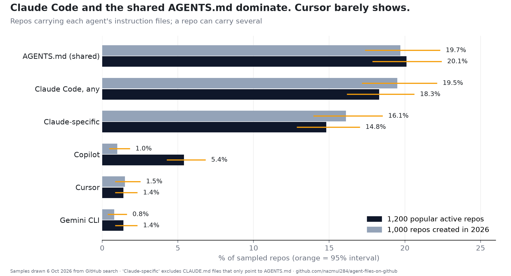
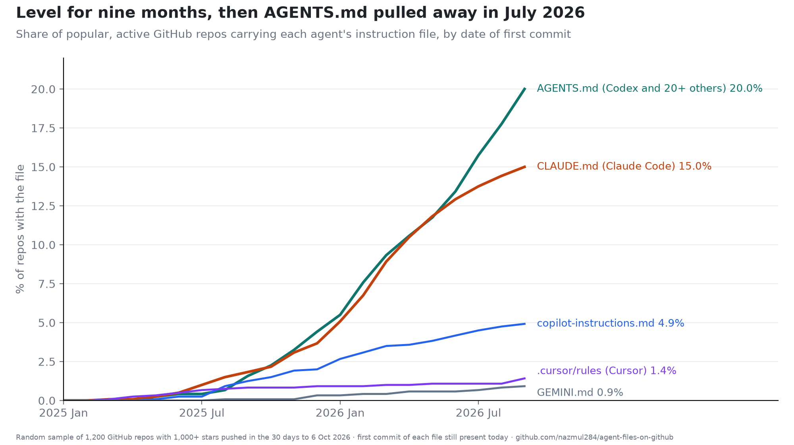

# agent-files-on-github

Which AI coding agent are GitHub repositories set up for? Random samples of 1,200 repos with
1,000+ stars pushed in the 30 days to 6 October 2026, and 1,000 repos created in 2026 with
100+ stars, each checked for every agent's instruction files, with the first-commit date of
each file. Companion data for *Claude Code vs Codex vs Cursor vs Copilot in 2,200 GitHub
Repos: 4 in 10 CLAUDE.md Files Just Point to AGENTS.md*.




## Results

```
Share of repos with each agent's instruction files, %

                          established       95% CI     new       95% CI
                                1,200                1,000
-----------------------   -----------  -----------   -----  -----------
any agent file                   30.2    27.7-32.9    30.0    27.2-32.9
AGENTS.md (shared)               20.1    17.9-22.4    19.7    17.4-22.3
Claude Code, any                 18.3    16.2-20.6    19.5    17.2-22.1
Claude-specific                  14.8    12.9-17.0    16.1    14.0-18.5
Copilot                           5.4      4.3-6.8     1.0      0.5-1.8
Cursor                            1.4      0.9-2.3     1.5      0.9-2.5
Gemini CLI                        1.4      0.9-2.3     0.8      0.4-1.6
Windsurf                          0.1      0.0-0.5     0.2      0.1-0.7
Cline                             0.1      0.0-0.5     0.1      0.0-0.6


What the root CLAUDE.md file actually is

                                established     new
                                        180     162
-----------------------------   -----------   -----
own instructions, 400+ bytes             93     107
short pointer to AGENTS.md               53      30
symlink to AGENTS.md                     29      21
short, other                              3       3
symlink, other                            2       1
pointer to AGENTS.md, %                  46      31


What is inside .claude/ folders (repos)

                      established     new
-------------------   -----------   -----
skills                         89      62
settings.json                  42      29
agents                         20      10
commands                       18      16
rules                          14       5
hooks                           9       7
CLAUDE.md                      12       2


Established repos by main language, %

language      repos  Claude Code  AGENTS.md
-----------   -----  -----------  ---------
Python          209         19.6       19.6
TypeScript      179         35.2       35.8
Go              109         22.0       21.1
JavaScript       92         10.9       10.9
C++              69         13.0       13.0
Rust             65         26.2       29.2
Java             65         16.9       29.2
C                56          1.8        8.9


Which files a repo carries together (repos)

combination                         established     new
---------------------------------   -----------   -----
AGENTS.md                                    99      93
Claude + AGENTS.md                           98      92
Claude                                       74      88
Copilot                                      31       0
Claude + AGENTS.md + Copilot                 18       2
Claude + AGENTS.md + Gemini CLI               9       3
```

## What counts as a signal

| Agent | Files |
|---|---|
| Claude Code | `CLAUDE.md` at root, `.claude/CLAUDE.md`, or a `.claude/` folder |
| Shared (Codex and 20+ others) | `AGENTS.md` at root |
| Cursor | `.cursor/rules/` or `.cursorrules` |
| Copilot | `.github/copilot-instructions.md` or `.github/instructions/` |
| Gemini CLI | `GEMINI.md` or `.gemini/` |
| Windsurf, Cline | `.windsurfrules`, `.windsurf/`, `.clinerules` |

A root `CLAUDE.md` counts as a pointer to `AGENTS.md` if it is a symlink to it, or under
400 bytes and mentions it (this rule was widened after reading the short files; see
`harness/analyze.py`).

## Reproduce

```
python harness/sample.py     # ~1,000 search calls; lists both populations in full, draws the samples
python harness/scan.py       # git trees and small blobs, cached in data/cache/ (not committed)
python harness/dates.py      # oldest commit per file
python harness/analyze.py && python harness/tables.py
uv run --with matplotlib python harness/charts.py results
```

Needs an authenticated `gh` CLI. Search results drift, so a rerun on another day draws a
different sample; `data/sample.json` pins the one used here.

## Limits

Files are not users; private editor rules are invisible; root files and three folders only;
dates come from the default branch and only see files that still exist.

## License

MIT
